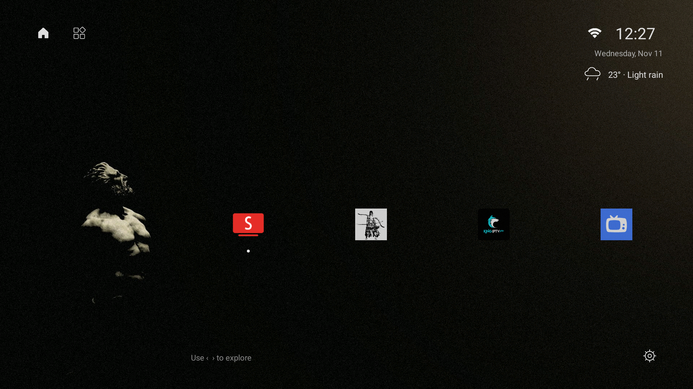

# Mono TV

A minimal Android TV launcher built with native Android views. Dark wallpaper, a single horizontal app row, and small monochrome controls. No ads, WebView, third-party runtime libraries, or continuously running weather service.



## Install

Download [Mono TV 2.8](releases/mono-tv-2.8.apk), enable ADB debugging on your TV, and run:

```sh
adb install -r mono-tv-2.8.apk
adb shell am start -n com.d4cx.tvlauncher/.MainActivity
```

Select **Mono TV** as your default Home app in the TV settings. To use the custom source picker over other apps, enable **Mono TV** in the TV's Accessibility settings. It handles the remote's input-source key; Back closes the picker. Input switching depends on the manufacturer's TV input services and was tested on a Xiaomi Mi TV, model MiTV_MZTU0, running Android 14.

The bundled APK is development-signed and matches the build installed during development. Keep your existing APK before replacing another launcher. Uninstalling an app erases its local preferences.

## Features

- One horizontally scrolling app row with installed app logos.
- Apps appear automatically when installed and disappear when uninstalled.
- Card-free app presentation with a subtle zoom and white dot on the selected app.
- Compact icon-only Home, Apps, Wi-Fi, and Settings controls.
- Thin rounded input picker: Home, HDMI ports, AV, and TV where available.
- Custom Wi-Fi discovery, password entry, and saved-network connection controls.
- Day/date and current weather below the clock.
- Distinct condition icons for clear day/night, clouds, fog, drizzle, rain intensity, freezing rain, snow, thunderstorms, and hail.

Home and Apps currently lead to the same installed-app row. The weather location is currently configured for **Tit Mellil, Morocco**; change the coordinates and label in `WeatherWidget.java` to customize it.

## Wi-Fi

Android requires Location to be enabled and the Location permission to be granted for nearby Wi-Fi scanning. The launcher requests the permission when needed. Scans occur when the panel opens or Refresh is selected; Android may throttle repeated scans.

The custom connection form supports WPA/WPA2 personal and open networks. Enterprise, WPA3-only, and WEP networks require advanced setup outside this panel. For connecting to networks, the app intentionally targets API 28: Android disables the legacy direct Wi-Fi configuration APIs for ordinary apps targeting API 29 and later. This project is intended for sideloading on a personal TV, not Google Play distribution.

Passwords are passed to Android's Wi-Fi configuration APIs and are not logged or stored in the launcher's preferences. Changing the TV's network can interrupt your ADB connection.

## Weather

Weather is fetched over HTTPS from [Open-Meteo](https://open-meteo.com/), with six-second connection/read timeouts. The compact response is cached locally. Updates run hourly while Home is visible; returning Home refreshes stale data. Failed requests retry after ten minutes while Home remains visible. Cached readings are labeled after an hour and replaced with an unavailable indicator after six hours. There is no weather service, alarm, or boot receiver keeping the app awake.

Select the weather row to see its last update and attribution. Conditions are model estimates and may differ from conditions at the exact TV location.

Weather data: Open-Meteo, [CC BY 4.0](https://creativecommons.org/licenses/by/4.0/). [API documentation and weather codes](https://open-meteo.com/en/docs).

## Build

Requirements:

- JDK 17
- Android SDK Platform 34
- Android SDK Build Tools 34.0.0

The Gradle wrapper uses Gradle 8.9 and Android Gradle Plugin 8.6.0. Set `ANDROID_HOME` to your Android SDK, or create an untracked `local.properties` containing `sdk.dir=/path/to/android-sdk`.

Linux/macOS:

```sh
chmod +x gradlew
./gradlew assembleRelease lintRelease
```

Windows PowerShell:

```powershell
.\gradlew.bat assembleRelease lintRelease
```

The APK is written to `app/build/outputs/apk/release/app-release.apk`.

Release builds currently use the local Android debug signing configuration for easy personal development. Signing keys are intentionally excluded from this repository. A build on another computer may use a different certificate and cannot update an existing installation unless it is signed with the same key. Configure your own private signing setup for a distributed release.

## Scope and performance

Minimum SDK: 24. Compile SDK: 34. Target SDK: 28.

The current APK is about 0.5 MB, including its wallpaper. RAM usage varies with device state and open panels; it is not guaranteed to stay at one fixed value. Icons are decoded at display size and reused. Focus and panel animations use short native view transforms.

The launcher does not force-stop other apps. Android manages their lifecycles, and Android 14 prevents ordinary third-party apps from killing other apps' background processes. Device-specific picture, sound, firmware, and system options still use the TV's settings.
